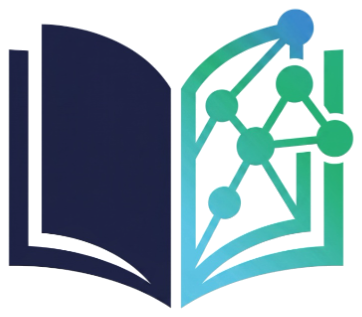
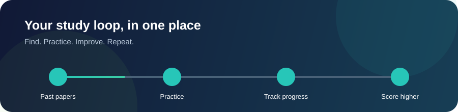

<div align="center">



# COMSATSPrepHub

### Your focused workspace for better exam preparation

Find past papers, practise with timed quizzes, revise with flashcards, and plan your GPA — all in one mobile-first app for COMSATS students.

<p>
  <a href="https://comsatsprephub.vercel.app"><strong>Open the live app →</strong></a>
  &nbsp;&nbsp;·&nbsp;&nbsp;
  <a href="https://github.com/MushtaqAhmadSaqi/COMSATSPrepHub/issues">Report an issue</a>
  &nbsp;&nbsp;·&nbsp;&nbsp;
  <a href="#getting-started">Run it locally</a>
</p>

<p>
  
  
  
  
</p>

</div>

<p align="center">
  
</p>

## 🧭 Find your next step

| I want to… | Go here |
|:---|:---|
| Browse solved COMSATS papers | [Past Paper Library](https://comsatsprephub.vercel.app/#subjects) |
| Test myself under exam conditions | [Timed Quizzes](https://comsatsprephub.vercel.app/#quiz) |
| Generate a custom AI quiz | [AI Quiz Generator](https://comsatsprephub.vercel.app/#ai-quiz-generator) |
| Build a daily revision habit | [Study Hub](https://comsatsprephub.vercel.app/#study-hub) |
| Calculate SGPA or target CGPA | [GPA Calculator](https://comsatsprephub.vercel.app/#gpa) |
| Track bookmarks and progress | [Dashboard](https://comsatsprephub.vercel.app/#dashboard) |

## ✨ What you can do

<table>
<tr>
<td width="50%" valign="top">

### 📚 Learn from real papers

Filter past papers by department, semester, year, and exam type. Read solutions in the LaTeX viewer, bookmark important questions, add notes, and turn a paper into a quiz.

</td>
<td width="50%" valign="top">

### ⏱️ Practise like the real exam

Switch between untimed practice and a 45-second-per-question exam mode. Mark questions for review, revisit wrong answers, and focus on weak topics.

</td>
</tr>
<tr>
<td width="50%" valign="top">

### 🤖 Make revision personal

Generate COMSATS-style MCQs or conceptual questions with the AI Quiz Generator. The server automatically falls back to other providers or the offline question bank when needed.

</td>
<td width="50%" valign="top">

### 📈 See your progress

Use daily challenges, streaks, spaced-repetition flashcards, course cheat-sheets, an exam planner, campus leaderboard, and a full SGPA/CGPA history.

</td>
</tr>
</table>

> **Built for flexibility:** Guest mode works without an account. Sign in with Supabase when you want cloud sync for progress, bookmarks, and exam countdowns.

## 🔁 A simple study loop

1. **Find** a paper for your course.
2. **Practise** with the paper or a timed quiz.
3. **Review** explanations and save difficult questions.
4. **Improve** with flashcards, weak-topic drills, and your GPA plan.

## 🚀 Getting started

### Prerequisites

- [Node.js](https://nodejs.org/) 18 or newer
- npm 9 or newer
- A Supabase project is optional for guest mode and required for cloud sync
- An AI provider key is needed only for live AI quiz generation

### 1. Install

```bash
git clone https://github.com/MushtaqAhmadSaqi/COMSATSPrepHub.git
cd COMSATSPrepHub
npm install
```

### 2. Configure optional services

Copy the example environment file and add the keys for the services you want to use:

```bash
cp .env.example .env
```

<details>
<summary><strong>Environment variables</strong></summary>

| Variable | Used by | Required | Purpose |
|:---|:---|:---:|:---|
| `VITE_SUPABASE_URL` | Browser | Optional | Supabase project URL |
| `VITE_SUPABASE_ANON_KEY` | Browser | Optional | Public Supabase key (RLS enforced) |
| `VITE_ADMIN_EMAILS` | Browser | Optional | Comma-separated admin emails |
| `VITE_GA_MEASUREMENT_ID` | Browser | Optional | Consent-gated Google Analytics ID |
| `GEMINI_API_KEY` | Server | Recommended | Primary AI provider |
| `GROQ_API_KEY` | Server | Optional | Secondary AI fallback |
| `OPENROUTER_API_KEY` | Server | Optional | Tertiary AI fallback |
| `SUPABASE_SERVICE_ROLE_KEY` | Server | Optional | Server-only quota verification |
| `UPSTASH_REDIS_REST_URL` | Server | Optional | Distributed rate limiting |
| `UPSTASH_REDIS_REST_TOKEN` | Server | Optional | Upstash Redis authentication |

</details>

### 3. Apply the database migration

Run the migrations in [`supabase/migrations/`](./supabase/migrations/) in timestamp order in the Supabase SQL Editor if you are enabling cloud features. The latest migration adds the live dashboard activity feed.

### 4. Start the app

```bash
npm run dev
```

Then open the local URL shown by Vite.

## 🛠️ Developer commands

| Command | What it does |
|:---|:---|
| `npm run dev` | Starts the Vite development server and quiz API |
| `npm run lint` | Runs the AST syntax and security linter |
| `npm run test` | Runs the application and API test suite |
| `npm run build` | Builds the production bundle |
| `npm run analyze` | Builds and generates bundle statistics |

## 🔐 Security at a glance

- AI provider keys stay on the server and are checked by the project linter.
- Supabase tables use Row Level Security (RLS).
- User input is sanitized and AI output is validated before rendering.
- Production security headers are configured in [`vercel.json`](./vercel.json).

<details>
<summary><strong>Project links</strong></summary>

- [Contributing guide](./CONTRIBUTING.md)
- [Security policy](./SECURITY.md)
- [MIT License](./LICENSE)

</details>
