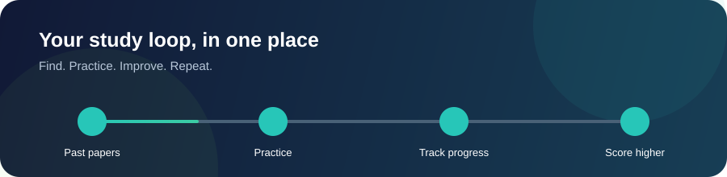

<div align="center">


# COMSATSPrepHub

### Prepare smarter. Practice better. Score higher.

<p>
  A focused, mobile-first exam-preparation workspace for COMSATS University students across all campuses.
  Find verified past papers, practice with timed &amp; AI-powered quizzes, review spaced-repetition flashcards, and calculate your SGPA/CGPA in one place.
</p>

<p>
  <a href="https://comsatsprephub.vercel.app">Live Demo</a>
  &nbsp;&middot;&nbsp;
  <a href="https://github.com/MushtaqAhmadSaqi/COMSATSPrepHub/issues">Report an Issue</a>
  &nbsp;&middot;&nbsp;
  <a href="https://github.com/MushtaqAhmadSaqi/COMSATSPrepHub">View Source</a>
</p>

<p>
  
  
  
  
</p>

</div>

<p align="center">
  
</p>

## 📸 Screenshots & Preview Placeholders

| Home & Global Course Search | Past Paper Viewer & Topic Insights | Timed Quiz & Bilingual Helper | COMSATS GPA & Target Planner |
|:---:|:---:|:---:|:---:|
| `docs/screenshots/home-preview.png` | `docs/screenshots/paper-viewer.png` | `docs/screenshots/quiz-mode.png` | `docs/screenshots/gpa-calculator.png` |

## ✨ Features

- **Past Paper Library (`/#subjects`)** — Filter by department, semester, year, and exam type (Midterm/Terminal/Quiz), with in-page zoom, bookmarks, personal notes, topic-frequency insights, and one-click *"Quiz from this paper"*.
- **Timed & Practice Quizzes (`/#quiz`)** — Switch between untimed practice and 45s/question exam timer mode, with a question navigator, mark-for-review, bilingual (`EN / اردو`) step-by-step explanations, wrong-answer review, and targeted weak-topic drills.
- **AI Quiz Generator (`/#ai-quiz-generator`)** — Generate custom COMSATS-style MCQs or conceptual questions with automatic server-side provider fallback (`Google Gemini` → `Groq` → `OpenRouter` → curated offline question bank).
- **Study Hub (`/#study-hub`)** — Daily 5-Question Challenge with streaks, Leitner spaced-repetition flashcards, high-yield course cheat-sheets, exam-date study planner, and an opt-in campus leaderboard.
- **COMSATS GPA & CGPA Calculator (`/#gpa`)** — Full COMSATS 4.00 grading scale with course retake replacement, Target CGPA calculator, Semester GPA History chart, and PDF/Print export.
- **Student Dashboard & Guest Mode (`/#dashboard`)** — Use quizzes, flashcards, and the GPA calculator without signing in, or sign in with Supabase to sync your progress, exam countdowns, and bookmarks.
- **PWA & Offline Support** — Installable mobile web app with service-worker caching and an offline status banner for unreliable campus Wi-Fi.

## 🚀 Getting Started

### Prerequisites

- [Node.js](https://nodejs.org/) 18 or newer
- npm 9+
- A Supabase project (optional for Guest Mode; required for cloud auth & database sync)
- At least one AI provider key (`GEMINI_API_KEY`, `GROQ_API_KEY`, or `OPENROUTER_API_KEY`) for live AI quiz generation

### 1. Clone and install

```bash
git clone https://github.com/MushtaqAhmadSaqi/COMSATSPrepHub.git
cd COMSATSPrepHub
npm install
```

### 2. Configure environment variables

Copy `.env.example` to `.env`:

```bash
cp .env.example .env
```

| Variable | Scope | Required | Description |
|---|---|---|---|
| `VITE_SUPABASE_URL` | Client (`VITE_`) | Optional (Guest mode fallback) | Your Supabase project URL |
| `VITE_SUPABASE_ANON_KEY` | Client (`VITE_`) | Optional (Guest mode fallback) | Your Supabase public `anon` key (RLS enforced) |
| `VITE_ADMIN_EMAILS` | Client (`VITE_`) | Optional | Comma-separated admin emails for UI route guard |
| `VITE_GA_MEASUREMENT_ID` | Client (`VITE_`) | Optional | Consent-gated Google Analytics 4 ID |
| `GEMINI_API_KEY` | Server (`/api` only) | Recommended | Google Gemini API key (primary AI provider) |
| `GROQ_API_KEY` | Server (`/api` only) | Optional | Groq API key (secondary fallback provider) |
| `OPENROUTER_API_KEY` | Server (`/api` only) | Optional | OpenRouter API key (tertiary fallback provider) |
| `SUPABASE_SERVICE_ROLE_KEY` | Server (`/api` only) | Optional | Server-only key for atomic quota RPC verification |
| `UPSTASH_REDIS_REST_URL` | Server (`/api` only) | Optional | Upstash Redis URL for distributed rate limiting |
| `UPSTASH_REDIS_REST_TOKEN` | Server (`/api` only) | Optional | Upstash Redis REST token |

### 3. Apply Supabase Row Level Security (RLS) migration

Open the Supabase SQL Editor and run:
- `supabase/migrations/20261027000000_rls_security_schema.sql`

### 4. Start developing

```bash
npm run dev
```

## 📜 Available Scripts

| Command | Description |
|---|---|
| `npm run dev` | Start the local Vite development server + `/api/generate-quiz` middleware |
| `npm run lint` | Run the AST syntax & security linter across `src/`, `api/`, and `tests/` |
| `npm run test` | Run the unit, GPA boundary, API validation, rate-limit, and security test suite |
| `npm run build` | Build the production bundle into `dist/` |
| `npm run analyze` | Build and generate `dist/bundle-stats.html` |

## 🔒 Security Architecture

- **Zero Client-Side AI Keys**: `GEMINI_API_KEY`, `GROQ_API_KEY`, and `OPENROUTER_API_KEY` are read exclusively inside `/api/generate-quiz.js` and enforced by `scripts/lint.cjs`.
- **Supabase RLS**: Every table (`profiles`, `past_papers`, `questions`, `user_subject_progress`, `user_quiz_attempts`, `user_visits`, `user_gpa_data`, `paper_bookmarks`, `paper_submissions`, `ai_quiz_usage`) has Row Level Security enabled.
- **Prompt Injection & XSS Defense**: User inputs are sanitized, isolated in XML tags, and validated against a strict JSON schema with HTML tag stripping before rendering.
- **Strict HTTP Headers**: Configured in `vercel.json` (`Content-Security-Policy`, `Strict-Transport-Security`, `X-Frame-Options`, `X-Content-Type-Options`, `Permissions-Policy`, `Cross-Origin-Opener-Policy`).

## 🤝 Contributing & License

Please read [CONTRIBUTING.md](./CONTRIBUTING.md) and [SECURITY.md](./SECURITY.md) before submitting a pull request. Licensed under the [MIT License](./LICENSE).
